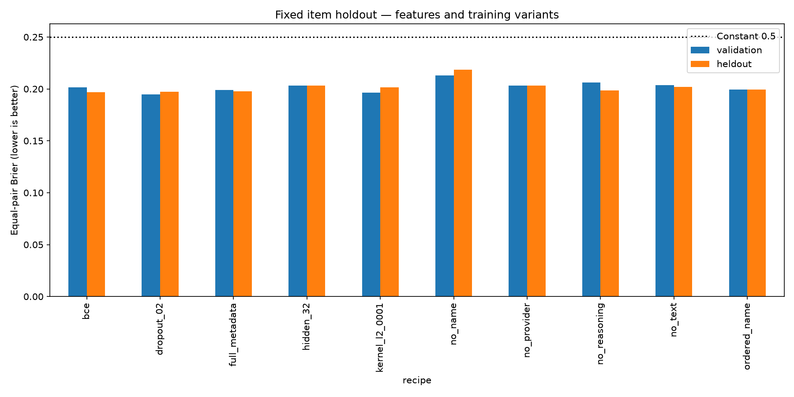

# Approach 1 feature transfer into Semantic IRT — November 7, 2026

The requested input/evaluation workflow is implemented and **25 full-cohort fits completed**. It does not establish an accuracy improvement. The validation-selected dropout recipe has outer item equal-pair Brier **0.197123**, versus the historical original 4PL model's **0.193620**. Its five-benchmark macro Brier is **0.315852**, versus **0.307516** previously. Lower is better. Preserve the original baseline; these experimental models do not replace its prediction adapter or become a production submission.

[Editable notebook](approach2_feature_transfer.ipynb) · [Shared report](reports/feature_transfer_20261107/) · [Selection receipt](reports/feature_transfer_20261107/selection.json) · [Verification summary](reports/feature_transfer_20261107/verification_summary.json) · [Embedding assessment](EMBEDDING_ASSESSMENT_2026-11-07.md). Full run checkpoints and response CSVs are retained locally, outside Git.

## Changes and controls

The legacy `models/Semantic_IRT.py`, `model.py`, old notebooks, data, splits, embeddings and historical results retain their prior meaning. The new `models/feature_irt.py` defines `ordered_metadata_4pl_v1`; its separate checkpoint loader rejects legacy checkpoint versions.

The new item parameters are `beta=z_beta`, `a=softplus(z_a)+0.1`, `c=0.3*sigmoid(z_c)`, and **`d=c+(1-c)*sigmoid(z_d)`**. Forward probabilities and parameter exports share this decoding, guaranteeing `0 <= c <= d <= 1` and nondecreasing correctness probability with scalar ability. Exported ability and item CSVs reconstruct the actual probabilities. Correcting this mathematical property is separate from improving predictive accuracy.

The full subject input is precisely Approach 1's `normalized_name`, `provider`, and `reasoning_effort`. Each field uses one-hot categories fitted on training rows only. Missing values become the empty string; an unseen category leaves that field's input zero, as in Approach 1. An unseen name can still use known provider/reasoning information. No subject ID, benchmark ID, display name, harness or outcome-derived feature is added.

The corrected name-only control preserves the old mean-training-name-ability fallback. Its initial parameter draws and category order match the old model, with the new bound formula as the intentional change. Adding full metadata also changes how unknown names are handled; its result measures that complete representation policy, not provider information in isolation. The no-provider/no-reasoning/no-name variants keep the metadata policy and remove one field each.

The text input remains the exact verified MiniLM cache: 2,048 content tokens, 512-token windows, normalized token-weighted pooling. The no-text control replaces every item vector with the same constant; it cannot distinguish items through their IDs. It tests the value of this text pipeline for this recipe, not the possible benefit from another encoder.

All fits reuse the **229,143 responses**, exact eligibility policy and recorded item/benchmark partitions. There are 139,782 training, 47,491 internal-validation and 41,870 outer-test item responses. Train/validation/test have disjoint item/prompt groups. All subjects remain included. Settings stay seed 5814, AdamW LR 0.0003, weight decay 0.00001, batch 512, maximum 100 epochs, early-stopping patience 10, scheduler patience 3/factor 0.5. Checkpoints minimize internal-validation equal-pair Brier.

Explicit kernel L2 0.0001 is an added penalty on linear-layer kernels; it is not a replacement name for AdamW weight decay or an exact reproduction of Keras's different architecture. Dropout, hidden size and BCE are separate trials; the prior A1 optimizer/batch/learning-rate recipe was not copied wholesale.

## Fixed item holdout

Scores below are **equal subject-ID/benchmark-pair Brier**, not response-weighted Brier. All ten trials were fitted with train/validation data first. `selection.json` locked the lowest validation score and checkpoint hashes before any new outer item predictions were computed. BCE's slightly lower observed outer score did not change the selected recipe.

| Recipe | Internal validation | Outer items | Best epoch |
|---|---:|---:|---:|
| Historical original 4PL, name only | 0.195932 | 0.193620 | 3 |
| New ordered 4PL, name only | 0.199261 | 0.199374 | 3 |
| Full metadata and text | 0.199111 | 0.197681 | 10 |
| Omit normalized name | 0.212829 | 0.218497 | 3 |
| Omit provider | 0.203190 | 0.203222 | 2 |
| Omit reasoning effort | 0.206151 | 0.198456 | 1 |
| Omit text | 0.203555 | 0.201783 | 3 |
| **Full inputs, dropout 0.2 — selected** | **0.194810** | **0.197123** | **2** |
| Full inputs, explicit kernel L2 0.0001 | 0.196280 | 0.201438 | 12 |
| Full inputs, 32 hidden units | 0.203427 | 0.203356 | 1 |
| Full inputs, BCE objective | 0.201633 | 0.196911 | 2 |
| Constant probability 0.5 | 0.250000 | 0.250000 | — |

Full metadata improves the outer item score by about 0.00169 against the corrected name-only control, but this single-seed difference does not establish a reliable gain. Full-input text improves about 0.00410 over the no-text control on outer items. The selected dropout model's **response-weighted** item-test Brier is 0.194023; its **equal-pair** score is 0.197123. These distinct weightings must not be interchanged.

The earlier matched Approach 1 M19 Brier recipe scored item-test equal-pair Brier 0.179812. These additions therefore do not close the previously observed A1/A2 gap.



## Repeated benchmark holdouts

The corrected name control, unregularized full inputs, and validation-selected dropout recipe were specified for the benchmark comparison. Each benchmark is absent from training and internal validation in its fold. Its checkpoint is chosen internally, and all unknown subjects stay in the denominator.

| Held-out benchmark | Ordered name | Full metadata | Full metadata + dropout |
|---|---:|---:|---:|
| MathArena | 0.407436 | 0.396573 | 0.428746 |
| Multi-SWE-bench | 0.249970 | 0.339525 | 0.267022 |
| WebAgents | 0.277682 | 0.295741 | 0.278329 |
| ResearchCodeBench | 0.302580 | 0.291185 | 0.291905 |
| SWE-rebench | 0.307708 | 0.341102 | 0.313258 |
| **Five-benchmark macro** | **0.309075** | **0.332825** | **0.315852** |

All three macro scores lose to constant 0.5 (0.25). Full metadata is worse on benchmark macro than the corrected name control. The present experiment supports neither adopting every A1 optimization nor treating the feature transfer as a solution to benchmark generalization.

These outer sets were already examined in earlier work and informed the project discussion. The new receipt establishes internal selection within this suite; it does **not** make the reused outer sets fresh prospective confirmation. There are no repeated seeds, uncertainty intervals or hosted results for this variant.

## Identity and embedding limits

Adding the actual A1 fields leaves important identity ambiguity: MathArena's 104 subject IDs become 53 metadata tuples rather than 46 names; Multi-SWE-bench's 82 subject IDs still become only 20 tuples. There are still 34,947 MathArena responses with blank names. The comparison does not invent missing identities or infer them from labels.

The separate [embedding assessment](EMBEDDING_ASSESSMENT_2026-11-07.md) records full-cohort token coverage and a controlled stronger-encoder proposal. No alternative encoder was downloaded, trained, evaluated or claimed to improve accuracy in this run.

## Reproduction and checks

Install the dependencies and configure the shared data paths described in the README, then run from PSN-IRT:

```bash
python run_feature_transfer.py --run-name feature_transfer_NEW_VERSION

python verify_feature_transfer.py results/chunked/experiments/feature_transfer_NEW_VERSION
```

The shared runner automatically selects CUDA, Apple GPU or CPU; `--device` overrides it. It refuses to overwrite an existing run. Its manifest freezes code snapshots, source hashes, library versions, data provenance, recipes and split records. Each fit records its actual device. The original cohort/vector guards remain active. Device portability was added after the recorded fits; their original source snapshots and receipts remain unchanged.

All 22 current regression checks passed. They include ordered bounds and ability monotonicity at extreme logits, legacy/control initialization, training-only categories, missing/unseen fields, provider use for unseen names, no-text identity, checkpoint rejection, best-weight restoration, retained outer subjects, numeric reconstruction from exported parameters, and automatic CPU selection when accelerators are unavailable.

The independent audit **passed all 25 fits**, checking all 229,143 response identities, labels, metadata and exact partitions per fit. It reproduced checkpoint probabilities, independently recalculated row/equal-pair scores and baseline means, verified category fitting, parameter bounds and exported-probability reconstruction, and hashed fold artifacts. Maximum prediction error was 2.98e-8; maximum error reconstructing probabilities from exported parameters was 1.97e-7. Recalculating metrics from float32 CSV predictions differed by at most 6.30e-9. All 21 checks present at training time passed. The three comparison/learning-curve figures were visually inspected.

No legacy formula was silently changed; no old result, Approach 1 artifact, course guide, source data, all-data submission bundle, remote branch or hosted submission was overwritten.
